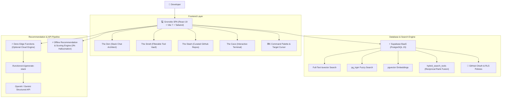

<div align="center">

```
             \                  /
    _________))                ((__________
   /        /)                  (\        \
  /________//   G R O N C K L E  \\________\
 /________//                      \\________\
           \      (o)   (o)      /
            \       \___/       /
             \                 /
```

# GRONCKLE 🐉
### *Hoard the Best. Build the Rest.*

**The developer intelligence vault and stack recommendation engine. Curated open-source repositories, developer tools, and interactive architectural planning.**

[](https://opensource.org/licenses/MIT)
[](https://www.typescriptlang.org/)
[](https://react.dev/)
[](https://vitejs.dev/)
[](https://tailwindcss.com/)
[](https://supabase.com/)
[](https://github.com/pgvector/pgvector)
[](https://nodejs.org/)

[Features](#-key-features) • [Architecture](#-architecture) • [Tech Stack](#-tech-stack) • [Quickstart](#-quickstart) • [Deployment](#-deployment) • [Contributing](#-contributing)

</div>

---

## 🌟 Why Gronckle?

Discovering lightweight, high-performance developer tools in a sea of sponsored posts and noisy feeds is broken. Top tools dominate social media while game-changing open-source gems and free developer services stay hidden.

**Gronckle** brings the perspective of an all-knowing dragon sleeping on a vault of battle-tested software. With Gronckle, you can:
- **Architect your project stack** interactively in **The Den** with natural language.
- **Filter and inspect 290+ tools** in **The Smelt** across license, language, category, and pricing.
- **Browse and clone curated open-source repositories** in **The Stash** with zero rate-limit friction.
- **Run terminal commands** in **The Cave** with a retro hacker console.

---

## 🚀 Key Features

### 1. 💬 The Den (Interactive Stack Architect)
- **Natural Language Stack Planning:** Describe what you are building (e.g., *"A real-time collaborative code editor with dark mode and zero telemetry"*).
- **Interactive Multi-Turn Chat:** Ask follow-ups, lock key technologies (like PostgreSQL or Next.js), and swap alternatives on the fly.
- **Strict Zero-Hallucination Guarantee:** Recommendations only reference tools verified in the database.
- **Instant Export:** Export your tailored stack architecture as a `package.json`, structured `README.md`, or interactive Mermaid diagram.

### 2. ⚡ The Smelt (The 290+ Tool Vault)
- **Granular Facet Filtering:** Filter by Category (Frontend, Backend, DevOps, DB, Auth, AI/ML), Framework, Language, License (MIT, Apache, GPL), and Pricing.
- **Real-Time Likes & Comments:** Optimistic liking, live comment threads, and Supabase Realtime synchronization.
- **Direct Dossier Pages:** Every tool features a dedicated deep-dive page (`/tool/:slug`) detailing maintenance status, license, repo metrics, and alternatives.

### 3. 📦 The Stash (Curated Open-Source Repositories)
- **Human-Curated Vault:** Hand-picked CLI tools, developer frameworks, and DevOps engines that actually work.
- **One-Click Terminal Clone:** Instant `git clone` copy action.
- **Community Submissions & Upvotes:** Developers can submit underrated repositories with crowdsourced verification.

### 4. 💻 The Cave (Interactive Retro Terminal)
- **Full Hacker Command Line:** Built-in interactive console with commands (`help`, `clear`, `den`, `smelt`, `stash`, `cave`, `whoami`, `about`, `changelog`).
- **Direct Support & Inquiries:** Submit messages directly to the team via the terminal input flow.

### 5. 🛡️ Identity & Developer UX
- **GitHub OAuth:** Fast, secure developer authentication via Supabase Auth.
- **Custom Bookmarks & Stacks:** Save your favorite tools and share your stack with unique deep links.
- **⌘K Command Palette:** Lightning-fast navigation with keyboard shortcuts (`Cmd+K` / `Ctrl+K`).
- **Custom Target Cursor:** Hardware-accelerated, responsive precision cursor for immersive interaction.

---

## 🏗️ Architecture



---

## 💻 Tech Stack

| Category | Technology |
|---|---|
| **Frontend Framework** | [React 19](https://react.dev/) + [TypeScript 5.9](https://www.typescriptlang.org/) |
| **Build Tool** | [Vite 7.3](https://vitejs.dev/) with SWC compiler |
| **Styling** | [Tailwind CSS 3.4](https://tailwindcss.com/) + Custom Void Black & Ember Orange theme |
| **Animations** | [Framer Motion 12](https://www.framer.com/motion/) + [GSAP 3](https://greensock.com/gsap/) |
| **UI Components** | [Radix UI Primitives](https://www.radix-ui.com/) + [Lucide Icons](https://lucide.dev/) |
| **Backend & Database** | [Supabase](https://supabase.com/) (PostgreSQL 15, `pgvector`, `pg_trgm`) |
| **Search Engine** | Hybrid RRF (tsvector + trigram fuzzy + pgvector cosine index) |
| **Serverless Compute** | Deno Edge Functions |
| **Testing** | Node test runner with `--experimental-strip-types` (40/40 passing) |

---

## 🛠️ Quickstart

### Prerequisites
- Node.js 20+ (recommended: Node.js 22 LTS)
- npm or pnpm

### 1. Clone the repository
```bash
git clone https://github.com/lithishkanna/Gronckle.git
cd Gronckle
```

### 2. Install dependencies
```bash
npm install
```

### 3. Setup environment variables
Create a `.env` file in the project root:
```bash
cp .env.example .env
```
Fill in your Supabase connection parameters:
```env
VITE_SUPABASE_URL=https://your-project.supabase.co
VITE_SUPABASE_ANON_KEY=your-supabase-anon-key
```

### 4. Run the development server
```bash
npm run dev
```
Open [http://localhost:5173](http://localhost:5173) in your browser.

---

## 🧪 Testing & Validation

Gronckle includes an automated test suite covering filter logic, scoring formulas, manifest parsing, and strict zero-hallucination validation:

```bash
# Run all 40 unit test suites
npm test

# Run build compilation and type check
npm run build
```

---

## 🚀 Deployment

Gronckle is designed to deploy seamlessly to any static hosting or JAMstack provider.

### Deploying to Vercel

[](https://vercel.com/new/clone?repository-url=https%3A%2F%2Fgithub.com%2Flithishkanna%2FGronckle)

1. Import the repository in [Vercel](https://vercel.com).
2. Set the build configuration:
   - **Framework Preset:** Vite
   - **Build Command:** `npm run build`
   - **Output Directory:** `dist`
3. Add environment variables:
   - `VITE_SUPABASE_URL`: Your Supabase Project URL
   - `VITE_SUPABASE_ANON_KEY`: Your Supabase Public Anon Key
4. Deploy!

### Deploying to Netlify / Cloudflare Pages
- **Build Command:** `npm run build`
- **Publish Directory:** `dist`
- Configure SPA fallback (redirect `/*` to `/index.html` with status 200).

---

## 📁 Project Structure

```
├── evals/                # Automated LLM recommendation evaluation harness
├── public/               # Public static assets & favicon
├── scripts/              # Data ingestion, seeding, and enrichment scripts
├── src/
│   ├── components/       # Reusable UI widgets, Modals, Cursor, DenStackChat
│   ├── hooks/            # Custom React hooks (useAuth, useMobile)
│   ├── lib/              # Core libraries (Supabase client, filters, search, recommendations)
│   ├── sections/         # Main views (IntelHub/Den, TheForge/Smelt, TheSource/Stash, TheTerminal/Cave)
│   ├── types/            # TypeScript database and model definitions
│   ├── App.tsx           # Main application routing and shell
│   └── main.tsx          # Application entry point
├── supabase/
│   ├── functions/        # Deno edge functions (generate-stack, github-proxy)
│   └── migrations/       # PostgreSQL schemas, RLS rules, and vector functions
└── tests/                # Unit test suites (ranking, filters, manifest parser)
```

---

## 🤝 Contributing

Contributions are welcome! Please follow these steps:

1. Fork the repository.
2. Create your feature branch (`git checkout -b feature/amazing-tool`).
3. Ensure all tests and type checks pass:
   ```bash
   npm test
   npm run build
   ```
4. Commit your changes (`git commit -m 'Add amazing new tool'`).
5. Push to the branch (`git push origin feature/amazing-tool`).
6. Open a Pull Request.

---

## 📜 License

Distributed under the **MIT License**. See [LICENSE](LICENSE) for details.

<div align="center">
  <sub>Crafted with 🔥 for developers who build. Maintained by <a href="https://github.com/lithishkanna">Lithish Kanna</a>.</sub>
</div>
